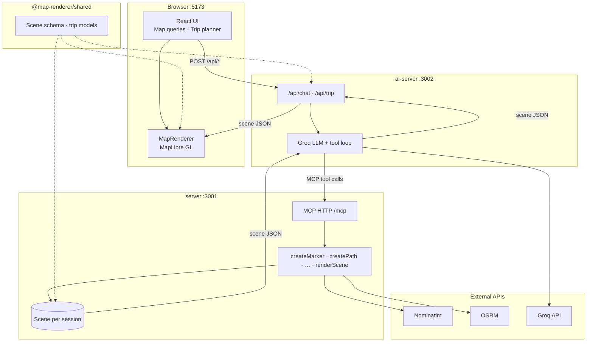

# GPT Maps

Turn map questions into live graphics. You chat in plain language; a **Groq**-powered agent calls **MCP tools** to build a geographic **scene**; **MapLibre** draws markers, driving routes, and region outlines on an interactive map.

**Demo:** [gpt-maps.onrender.com](https://gpt-maps.onrender.com) · **Upstream:** [SiddharthGoel-07/GPT-MAPS](https://github.com/SiddharthGoel-07/GPT-MAPS)

---

## Highlights

| Mode | What you get |
|------|----------------|
| **Map queries** | “Show Delhi and Mumbai and connect them” → geocoded pins, OSRM paths, optional region polygons |
| **Trip planner** | Multi-day itineraries, per-day maps, budget view, section follow-up chat |
| **MCP server** | Same drawing logic for browser or Claude Desktop–style MCP hosts (one scene per session) |

**Map objects:** markers, labels, paths (road or straight-line fallback), polygons (Nominatim boundaries, simplified for large areas).

**MCP tools:** `createMarker` · `createLabel` · `createPath` · `createPolygon` · `removeObject` · `clearScene` · `renderScene`

---

## Architecture



| Package | Responsibility |
|---------|----------------|
| `@map-renderer/shared` | Zod scene schema, types, trip JSON models |
| `@map-renderer/server` | MCP HTTP, geocoding, routing, boundaries |
| `@map-renderer/ai-server` | `/api/chat`, `/api/trip`, conversation + MCP sessions |
| `@map-renderer/web` | UI, map rendering, Vite proxy `/api` → ai-server |

---

## Quick start

**Needs:** Node 20+, npm, at least one [Groq](https://console.groq.com/) API key.

```bash
git clone https://github.com/SiddharthGoel-07/GPT-MAPS.git
cd GPT-MAPS
npm install
npm run build -w @map-renderer/shared
```

Create `packages/ai-server/.env` from `.env.example`:

```env
GROQ_API_KEY_1=gsk_...
MCP_SERVER_URL=http://127.0.0.1:3001/mcp
PORT=3002
GROQ_MODEL=openai/gpt-oss-20b
```

Run everything from the repo root:

```bash
npm run dev
```

Open **http://localhost:5173** — **Map queries** or **Trip planner** in the header.

> **Tip:** Other packages import `@map-renderer/shared` from **`dist/`**. If you see “does not provide an export named …”, run `npm run build -w @map-renderer/shared` (or use root `npm run dev`, which builds shared first).

Optional `packages/server/.env`: `MCP_AUTH_TOKEN`, body-size limits, Nominatim pacing — see `httpGuard` / server config in code.

---

## Commands

| Script | Use |
|--------|-----|
| `npm run dev` | Shared watch + server + ai-server + web |
| `npm run dev:server` / `dev:ai` / `dev:web` | One service only |
| `npm run build` | Production build all workspaces |
| `npm test` | Unit + integration harnesses |
| `npm run verify` | build + test + lint |

---

## Stack

TypeScript · Model Context Protocol · MapLibre GL · React · Vite · OpenStreetMap / Nominatim · public OSRM routing
